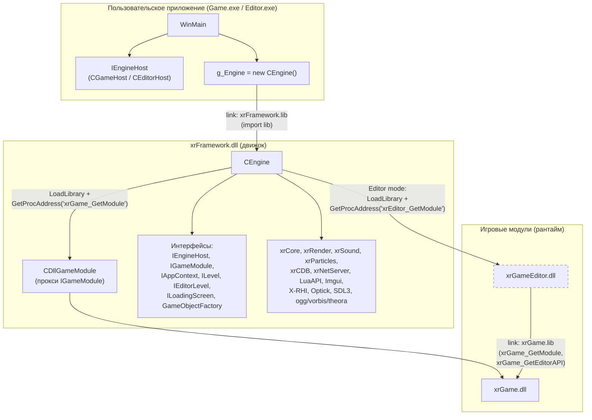
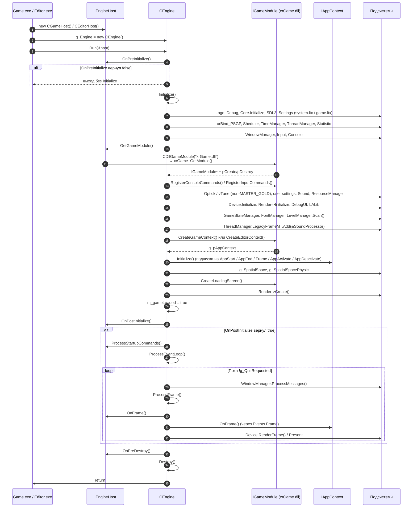
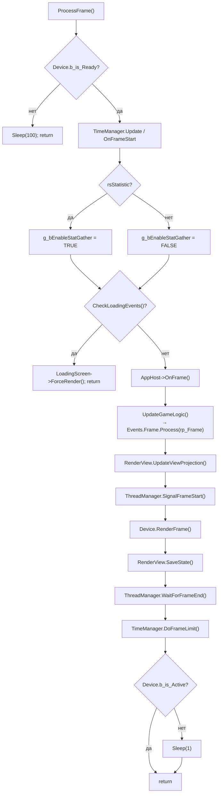

# xrFramework

<p align="center">
  
  <a href="https://github.com/Nocturning-studio/xrFramework/actions/workflows/build.yml">
    
  </a>
  <a href="https://github.com/Nocturning-studio/xrFramework/stargazers">
    
  </a>
  <a href="https://discord.gg/XXvxtnDbBP">
    
  </a>
  
</p>

---

## 📖 Оглавление

- [О проекте](#-о-проекте)
- [Философия проекта](#-философия-проекта)
- [Чем xrFramework отличается от X-Platform](#-чем-xrframework-отличается-от-x-platform)
- [Архитектура](#-архитектура)
- [Ключевые особенности](#-ключевые-особенности)
- [Структура проекта](#-структура-проекта)
- [Сборка](#-сборка)
- [Запуск](#-запуск)
- [План развития](#-план-развития)
- [Системные требования](#-системные-требования)
- [Лицензия](#-лицензия)
- [Контакты](#-контакты)
- [Благодарности](#-благодарности)

---

## 🚀 О проекте

**xrFramework** — это проект, выросший из [X-Platform](https://github.com/Nocturning-studio/X-Platform). Если X-Platform развивает оригинальный **X-Ray Engine 1.0**, сохраняя обратную совместимость и не ломая кодовую базу, то xrFramework — это **радикальная переработка с политикой нулевой терпимости к обратной совместимости**. Здесь нет задачи «не сломать моды» - мы строим новый движок заново, правильно.

**Главная цель xrFramework — полностью разделить игровой движок и игру.**

Исторически X-Ray Engine сложился так, что важный код имплементировался прямо в игровом модуле: интерфейсы актёров, физика, интеграция скриптового языка, редактор уровней как отдельная сущность «на сдачу». Движок был беден, а игра — раздута. xrFramework **не пытается сделать движок «богатым»**. Он стремится сделать движок **фреймворком** — набором инструментов, поверх которых пользователь не только сможет пользоваться оригинальным игровым модулем сталкера, но и создавать собственные игры.

**Что даёт xrFramework:**
- рендер и звуковой движок;
- инструменты работы с памятью, окнами, UI, отладкой;
- task-based многопоточность;
- базовые игровые сущности (объекты, уровни, планировщик обновлений);
- чёткие интерфейсы (`IEngineHost`, `IGameModule`, `IAppContext`, `ILevel`, `ILoadingScreen`, `GameObjectFactory`), через которые игра подключается к движку.

Движок больше **не является исполняемым файлом** — это библиотека `xrFramework.dll`, которая подключается к пользовательскому приложению. Игровой модуль (`xrGame.dll`) - сменный плагин, загружаемый в рантайме.

Проект находится на **раннем этапе развития**. В качестве полигона для отладки фреймворка и примера его использования выступает игровой модуль S.T.A.L.K.E.R. Shadow of Chernobyl.

---

## 🧭 Философия проекта

1. **Нулевая терпимость к обратной совместимости.** Если старый код мешает - он переписывается полностью, без сохранения обратной совместимости со старым API и именами методов или сущностей.
2. **Движок — это фреймворк, а не игра.** Если Unreal Engine и другие "богатые" движки дают полноценные интерфейсы актеров и множества других сущностей со своей стороны в игровой модуль, где вы можете их использовать, а также дают полноценный редактор, абстрагированный от конкретной игры, который вы сами привязываете к вашей игре, то в данном проекте, это не так. Движок является базой инструментов для разработки игры и редактора вашей игры. Это звучит очень грустно, но наша задача не просто свалить написание игры и редакторов на пользователя, а дать ему качественные инструменты и понятный API, а также дать примеры реализации.
3. **Игра — это плагин.** Игровой модуль реализует `IGameModule` и загружается в рантайме, вы можете реализовывать игру хоть в отдельном модуле, хоть в том же исполняемом файле, в который подключаете xrFramework, вы полностью свободны.
4. **Редактор — часть игры, а не отдельная сущность.** WYSIWYG-редактор полностью завязан на игровом модуле и встраивается в него, для того чтобы не создавать огромное количество абстракций, усложняющих работу с игровым миром. Если вы хотите создать в вашем мире конкретный класс артефакта - вы просто используете для редактора конкретный класс артефакта, вместо создания абстрактного игрового объекта с дополнительной морокой.
5. **Полностью новый рендер** Оригинальные рендеры X-Ray Engine писались по накатанной. Даже для DX11 рендера в Зове Припяти не писалась действительно новая архитектура с новым рендер пайплайном - разработчики просто посадили на рельсы DX11 имевшийся DX10 рендер, который точно также был DX9 рендером, посаженным на DX10. Все это создавало порочный круг бесконечного количества врапперов и кастылей. Мы полностью выкидываем оригинальный рендер и пишем новый, специально чтобы сделать возможными стриминг ассетов, pipeline based архитектуру, правильное разделение на фронтенд, бекенд и RHI и современные концепции вроде GPU Driven occlusion culling, vis буфферы и так далее.

---

## 🔀 Чем xrFramework отличается от X-Platform

| Аспект | **X-Platform** | **xrFramework** |
|---|---|---|
| Отношение к наследию X-Ray | Развитие с сохранением совместимости | Полная переработка, нулевая терпимость |
| Движок | Исполняемый файл + модифицированный код | **Библиотека** `xrFramework.dll` |
| Игровой модуль | Встроен в движок | **Сменный плагин** `xrGame.dll` / `xrGameEditor.dll` |
| Редактор | Отдельная сущность «на сдачу» | **WYSIWYG-редактор внутри игрового модуля** |
| Рендер | Раскрытие потенциала DX9-рендера, без перехода на более новые API | **Новый рендер с нуля** (DX12, стриминг, GPU-driven occlusion culling, RT, чанкование мира) |
| Архитектура | x86, монолит | **x64**, разделение engine / game / host |
| Скрипты | Старый LuaJIT | **Lua 5.1 + LuaJIT 2** |
| Цель | Улучшить S.T.A.L.K.E.R. | **Позволить создавать собственные игры на X-Ray** |

---

## 🏗 Архитектура

### Как линкуются движок и игровой модуль



**Ключевые точки линковки:**

- **`Game.exe` / `Editor.exe`** линкуются с `xrFramework.lib` (импорт-либ) и включают заголовки `xrFramework/xrFramework.h`, `xrFramework/IEngineHost.h`, `xrFramework/IGameModule.h`. Прямого знания о конкретной игре у хоста нет.
- **`xrFramework.dll`** собирает в себя `xrCore`, `xrRender`, `xrSound`, `xrCDB`, `xrParticles`, `xrNetServer`, `LuaAPI`, `Imgui`, `X-RHI`, `Optick`, `SDL3`, `ogg/vorbis/theora` (см. `AdditionalOptions /WHOLEARCHIVE:...` в `xrFramework.vcxproj`).
- **`xrGame.dll`** грузится **в рантайме** через `CDllGameModule`. Экспортирует `xrGame_GetModule()` (→ `IGameModule*`) и `xrGame_GetEditorAPI()` (→ `SEditorGameAPI*`).
- **`xrGameEditor.dll`** грузится в Editor-режиме через `xrEditor_GetModule()`, а внутри **линкуется с `xrGame.lib`** и оборачивает `IGameModule` из `xrGame.dll`.

### Инициализация движка



### Что делает `ProcessFrame()`



---

## ✨ Ключевые особенности

| Технология | Описание |
|---|---|
| **Framework-first архитектура** | Движок — библиотека, игра — плагин. Чёткое разделение через `IEngineHost` / `IGameModule`. |
| **Сменный игровой модуль** | `xrGame.dll` (SoC) загружается в рантайме; можно написать свою игру на `IGameModule`. |
| **Новый рендер с нуля** | DX12, стриминг ассетов, GPU Driven Occlusion Culling, трассировка лучей, чанкование мира. |
| **x64** | Движок переводится на x64. |
| **Lua 5.1 + LuaJIT 2** | Скриптовый слой уже переведён. |
| **WYSIWYG-редактор** | Полностью завязан на игровом модуле, встраивается в него (`IEditorLevel`). |
| **Task-based многопоточность** | `CThreadManager` с `LegacyFrameMT` и `WaitForFrameEnd()`. |
| **Профилирование** | Optick + встроенные `PROFILE_FUNCTION` / `OPTICK_EVENT`. |
| **Гибкая работа с ресурсами** | `CResourceManagerLegacy`, вынесенные шейдеры, авто-декодер ресурсов. |

---

## 📁 Структура проекта

```
xrFramework/
├── game_filesystem.ltx             ← дескриптор файловой системы игры
├── Appdata/
│   └── user_game_settings.ltx
├── Archives/                       ← .db* архивы игры
├── Gamedata/                       ← незапакованные ресурсы вашего мода
├── Engine/
│   └── Sources/
│       ├── Engine/                 ← сам движок
│       │   ├── xrCore/             ← ядро (память, FS, конфиги, утилиты)
│       │   ├── xrMath/             ← математика
│       │   ├── xrRender/           ← рендер (новый бэкенд + legacy)
│       │   ├── xrSound/            ← звук
│       │   ├── xrParticles/        ← партиклы
│       │   ├── xrCDB/              ← коллизии
│       │   ├── xrNetServer/        ← сеть
│       │   └── xrFramework/        ← ★ ФРЕЙМВОРК (CEngine, интерфейсы, RHI)
│       ├── Game/                   ← игровые приложения и модули
│       │   ├── STK-Game/           ← Game.exe (SoC-host)
│       │   ├── STK-Editor/         ← Editor.exe (SoC-editor-host)
│       │   └── xrGameEditor/       ← xrGameEditor.dll (обёртка над xrGame)
│       ├── Third-party/            ← сторонние библиотеки (LuaAPI, Optick, X-RHI, Imgui, …)
│       └── QOL&Network/            ← утилиты и сетевые инструменты
└── Binaries/
    └── ($PlatformShortName)/
        ├── Game.exe                ← хост-приложение игрового режима
        ├── Editor.exe              ← хост-приложение режима редактора
        ├── xrFramework.dll         ← движок как библиотека
        ├── xrGame.dll              ← игровой модуль (SoC)
        └── xrGameEditor.dll        ← редакторный модуль
```

---

## 🔨 Сборка

1. Установите **Visual Studio 2019** (или новее) с набором инструментов **v142**.
2. Склонируйте репозиторий:
   ```bash
   git clone https://github.com/Nocturning-studio/xrFramework.git
   ```
3. Откройте решение `xrEngine.sln` в Visual Studio.
4. Выберите в качестве собираемого проекта **xrFramework**, **Game** и **Editor** (или соберите всё решение).
   > `xrFramework.dll` соберётся вместе с зависимостями (`xrCore`, `xrRender`, `xrSound` и т.д.), а все нужные библиотеки и конфиги скопируются в выходную папку.

---

## ▶️ Запуск

### Игровой режим (S.T.A.L.K.E.R. Shadow of Chernobyl)

1. Скачайте `gamedata` из репозитория [X-Projects](https://github.com/Nocturning-studio/X-Projects).
2. Поместите содержимое в папку `Gamedata` в корне с игрой.
3. Создайте папку `Archives` рядом с `Gamedata` и положите туда `.db*` архивы игры.
4. Запустите `Binaries/($PlatformShortName)/Game.exe`.

### Режим редактора

1. Запустите `Binaries/($PlatformShortName)/Editor.exe`.
2. Хост загрузит `xrGameEditor.dll`, который обернёт `xrGame.dll` через `SEditorGameAPI` и создаст `CEditorLevel`.

---

## 🗺 План развития

- [x] Разделение движка и игрового модуля на две сущности.
- [x] Движок как библиотека (`xrFramework.dll`), а не `.exe`.
- [x] Переход на **Lua 5.1 / LuaJIT 2**.
- [x] Хост-приложения `Game.exe` и `Editor.exe`, вынесенные из движка.
- [ ] **Новый WYSIWYG-редактор**, полностью встроенный в игровой модуль (`IEditorLevel`).
- [ ] **Новый рендер с чистого листа**: DX12, стриминг ассетов, GPU Driven Occlusion Culling, трассировка лучей, чанкование мира.
- [ ] Полный перевод движка на **x64**.
- [ ] Стабилизация `IGameModule` как публичного API для сторонних игр.
- [ ] Документация по написанию собственных игр поверх фреймворка.
- [ ] Семплы игр и образцы редакторов к ним

---

## 💻 Системные требования

| Компонент | Минимальные | Рекомендуемые |
|---|---|---|
| **ОС** | Windows 7 (x64) | Windows 11 (x64) |
| **Процессор** | Intel Core i5 2400 / AMD FX 4300 | Intel Core i5 8400 / Ryzen 5 1600 |
| **ОЗУ** | 4 GB | 8 GB+ |
| **Видеокарта** | GTX 750 Ti | RX 580 |

> Требования указаны для текущего состояния (полигон SoC).

---

## 📄 Лицензия

Проект распространяется на условиях **PolyForm Noncommercial 1.0.0**.

- **xrFramework Code** (код, созданный Nocturning Studio и независимыми контрибьюторами) — под лицензией PolyForm Noncommercial 1.0.0. Коммерческое использование запрещено без отдельного разрешения, код полностью открыт для любого некоммерческого использования. Вы можете копировать и менять код как угодно, сохранение копирайтов не является строго обязательным, но мы будем рады их сохранению.
- **GSC Game World Proprietary Code** — оригинальный код X-Ray Engine остаётся под проприетарной лицензией GSC Game World, мы не имеем права как-либо менять условия лицензирования этого кода, поэтому при любом использовании вам необходимо сохранять текст лицензии GCS в вашем коде в неизменном виде. Коммерческое использование кода GSC строго запрещается
- **Third-Party Components** — сторонние библиотеки (LuaAPI, Optick, X-RHI, Imgui, SDL3, ogg/vorbis/theora и др.) распространяются на условиях их собственных лицензий.

Полный текст лицензии доступен в файле [LICENSE](LICENSE) или на сайте [PolyForm Project](https://polyformproject.org/licenses/noncommercial/1.0.0).

---

## 📬 Контакты

- **Discord**: [Присоединиться к серверу](https://discord.gg/XXvxtnDbBP)
- **GitHub Issues**: [Создать issue](https://github.com/Nocturning-studio/xrFramework/issues)

---

## 🙏 Благодарности

- **GSC Game World** — за оригинальный X-Ray Engine.
- **Nocturning Studio** — за координацию и развитие проекта.
- **Все контрибьюторы** — за вклад в код, тестирование и документацию.
- **Авторам DeepSeek** — за сэкономленные нервы и дни дебаггинга.
